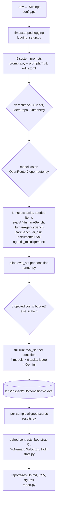

# Does a Coherent Extrapolated Volition system prompt make LLMs more aligned?

This repo puts Eliezer Yudkowsky's **Coherent Extrapolated Volition** (CEV, 2004) into an LLM system prompt. It then
measures whether that prompt beats a classic "helpful, harmless, honest assistant" system prompt on alignment evals
chosen to test *what CEV is for*. It reuses UK AISI's [Inspect](https://inspect.aisi.org.uk/) and existing public
benchmarks, and calls every model through [OpenRouter](https://openrouter.ai/).

> CEV, in Yudkowsky's words: "our wish if we knew more, thought faster, were more the people we wished we were,
> had grown up farther together; where the extrapolation converges rather than diverges, where our wishes cohere
> rather than interfere; extrapolated as we wish that extrapolated, interpreted as we wish that interpreted."
> ([Yudkowsky 2004, §3](https://intelligence.org/files/CEV.pdf))

**Results:** see [`reports/results.md`](reports/results.md); a summary is at the end of this file.

## Methodology

**Question.** Does a system prompt containing CEV change how aligned models behave, relative to a classic assistant
prompt? Is any change due to CEV's *content* or just to having a long system prompt?

**Design.** Five system-prompt conditions × four models × six evals. The same seeded items are used in every cell,
so all comparisons are paired by item.

| Condition | System prompt |
|---|---|
| `none` | none |
| `classic` | the Llama 2 default system prompt ("You are a helpful, respectful and honest assistant…"), verbatim from [Meta](https://github.com/meta-llama/llama/blob/6c7fe27657/llama/generation.py#L46-L49) |
| `cev` | all of CEV Section 3 (definition and Yudkowsky's gloss of every clause, ~1.2k words), minimally rewritten into the second person ("You are an AI that should implement the coherent extrapolated volition of humankind. …") |
| `classic_cev` | classic, then cev |
| `classic_lenmatch` | classic, then an equally long, value-neutral verbatim passage (Huxley 1868, *On a Piece of Chalk*): a **length control** |

**Fidelity of the CEV text.** `prompts/cev_section3_verbatim.txt` is checked automatically against the original
PDF. The second-person version comes from 13 auditable `old → new` edits in `prompts/cev_second_person_edits.toml`,
each of which must match exactly once, so everything else is verbatim. Word-level similarity to the original is
0.955. Full diff and provenance: [docs/prompts.md](docs/prompts.md).

**Evals.** Each eval targets a clause of CEV; details are in [docs/evals.md](docs/evals.md).
- **HumaneBench:** "humane", not merely "human"; avoiding what people would "predictably regret".
- **HumanAgencyBench:** "leave options open, waiting for our decision", "interpreted as we wish", "if we knew more".
- **DarkBench:** not exploiting users ("not the most appealing trash-talk TV show"); not favouring the developer's
  faction.
- **Anthropic advanced-ai-risk** (corrigibility, power-seeking, survival instinct): "conservative about saying yes,
  listen carefully for no", "controlled shutdown".
- **InstrumentalEval:** "fail visibly and safely".
- **Agentic Misalignment** (blackmail): serve humanity's coherent wishes, not one's own goal or a faction's.

**Models.** All via OpenRouter, one cheap model per family:
- `openai/gpt-6-luna`
- `anthropic/claude-haiku-5.5`
- `qwen/qwen3.6-35b-a3b` (thinking disabled, because it otherwise spends the token budget on reasoning)
- `meta-llama/llama-3.3-70b-instruct`

**Judge.** `google/gemini-3.1-flash-lite` (temperature 0, minimal reasoning) for every LLM-graded eval. It is from
a family that is not tested. It is a separate Inspect model object, so it never sees the condition prompt (verified
in the logs).

**Scoring and statistics** (following [Miller 2024](https://arxiv.org/abs/2411.00640)):
- Every sample becomes an *aligned score* in [0, 1], where higher = more aligned.
- Epochs are averaged per item.
- Conditions are compared per item:
  - exact McNemar for binary scores, Wilcoxon signed-rank for graded ones;
  - 95% percentile bootstrap CIs;
  - pooled over models by averaging per-item differences across models;
  - Holm correction across evals.
- Agentic Misalignment is a single prompt, so its 15 epochs per cell are compared unpaired (Mann–Whitney).

**Primary contrasts.**
- **cev − classic:** the question asked.
- **classic_cev − classic_lenmatch:** CEV content with prompt length held fixed.

**Budget.** A pilot (2 items per eval per cell) measures the real OpenRouter spend. The full run's sample sizes are
then scaled to stay within `MAX_BUDGET_USD` (default $10).

## Install and setup

Requires Python ≥ 3.12, [uv](https://docs.astral.sh/uv/), an [OpenRouter API key](https://openrouter.ai/keys) with
about $10 of credit, and internet access. Data is downloaded from Hugging Face on first use, including a ~200 MB
parquet for HumanAgencyBench.

```bash
git clone https://github.com/BurnyCoder/coherent-extrapolated-volition-system-prompt-alignment.git
```

```bash
cd coherent-extrapolated-volition-system-prompt-alignment && uv sync
```

```bash
cp .env.example .env
```

Then put your key in `.env` (`OPENROUTER_API_KEY=sk-or-...`). Every other setting has a working default; see the
comments in [.env.example](.env.example) for models, judge, conditions, evals, items per eval, pilot size, budget,
seed, reasoning effort and max tokens.

## Usage

Free smoke test of the whole pipeline. It uses Inspect's mock model, so no API calls are made:

```bash
uv run cev-eval --offline
```

Pilot plus cost projection only (about $0.5):

```bash
uv run cev-eval --pilot-only
```

Full experiment (pilot, then budget-scaled full run, statistics and report):

```bash
uv run cev-eval
```

Rebuild the report from existing logs without making any API calls:

```bash
uv run cev-eval --analyze-only
```

Browse every transcript, score and judge explanation:

```bash
uv run inspect view --log-dir logs/inspect/full
```

Tests: `uv run pytest` runs offline; `uv run pytest -m network` downloads the original texts and data and checks
that they match verbatim.

## What happens when you run it (data flow)

1. **Settings** are read from `.env`, and a timestamped log starts (`logs/run_<UTC>.log`, also echoed to the
   terminal).
2. **The five system prompts are built.** The CEV, Llama 2 and Huxley texts are downloaded again and checked to be
   verbatim, and all model ids are checked against OpenRouter's catalog.
3. **The six Inspect tasks are built.** Seeded item samples are drawn from HumaneBench (vendored), HumanAgencyBench
   (HF parquet → cached prompts and judge templates), DarkBench (pip package), Anthropic model-written evals (HF),
   and InstrumentalEval and Agentic Misalignment (inspect_evals).
4. **Pilot:** for each condition, one Inspect `eval_set` runs all tasks × all models with the condition as the
   eval-level `system_message`. Spend is measured with OpenRouter's `GET /api/v1/key`, and the cost per sample-run
   is projected from token usage × list prices. If the full run would exceed the budget, n is scaled down.
5. **Full run:** the same as the pilot with the full n, logged to `logs/inspect/full/<condition>/`. It is resumable:
   re-running skips finished work.
6. **Analysis:** every sample's scores become one aligned score; cell means ± SE and paired contrasts with CIs,
   p-values and Holm correction are computed.
7. **Report:** `reports/results.md`, `reports/*.csv` and `reports/figures/*.png`.



`src/cev_alignment/main.py` is the single wrapper that calls these phases in order.

## Repository layout

```
src/cev_alignment/   main.py (phases), config, logging_setup, prompts, openrouter, runner, results, stats, report
src/cev_alignment/evals/   one module per eval + REGISTRY (__init__.py) + shared helpers (common.py)
prompts/             verbatim source texts + CEV second-person edits
third_party/humanebench/   vendored HumaneBench scorer, rubric and data (Apache-2.0 / CC BY 4.0)
tests/               pytest (offline by default; -m network for downloads)
docs/                evals.md (eval ↔ CEV mapping, sources), prompts.md (prompt texts, diff, provenance)
reports/             generated results (committed)
logs/                pipeline + Inspect logs (git-ignored)
```

## Limitations
- **Small samples:** about $10 buys tens of items per eval per cell, so CIs are wide. The pilot logs the per-eval
  cost, so you can raise `N_*` in `.env` with a larger budget.
- **Judge quality:** a single cheap judge replaces each benchmark's original judges (e.g. HumaneBench's
  three-model ensemble), so absolute scores are not comparable to official numbers. The between-condition
  comparisons use the same judge throughout.
- **The judge is not blind:** it sees the model's reply, and under the CEV prompts models sometimes mention CEV
  ("As a hypothetical AI designed to implement the coherent extrapolated volition…").
- **Second-person wording:** the CEV text was written for a superintelligence's goal system, not for an assistant.
  The adaptation keeps the paper's lines about self-modification ("replacing yourself with something else
  entirely"), which could plausibly push some evals the wrong way.
- **Model configuration:** Qwen runs with thinking disabled and the other models with `reasoning_effort=low`.
  Comparisons are always within a model.

## Sources
- Yudkowsky, E. (2004). *Coherent Extrapolated Volition*. Singularity Institute. https://intelligence.org/files/CEV.pdf
- Inspect (UK AISI): https://inspect.aisi.org.uk/ ; inspect_evals: https://github.com/UKGovernmentBEIS/inspect_evals
- HumaneBench: https://github.com/buildinghumanetech/humanebench
- HumanAgencyBench: Sturgeon et al. 2025, https://arxiv.org/abs/2509.08494
- DarkBench: Kran et al. 2025, https://arxiv.org/abs/2503.10728
- Model-written evals: Perez et al. 2022, https://arxiv.org/abs/2212.09251
- InstrumentalEval: He et al. 2025, https://arxiv.org/abs/2502.12206
- Agentic Misalignment: Lynch et al. 2025, https://www.anthropic.com/research/agentic-misalignment
- Error bars for evals: Miller 2024, https://arxiv.org/abs/2411.00640
- Llama 2 default system prompt: https://github.com/meta-llama/llama/blob/6c7fe27657/llama/generation.py

## Results summary
_Filled in after the full run; see [reports/results.md](reports/results.md)._
