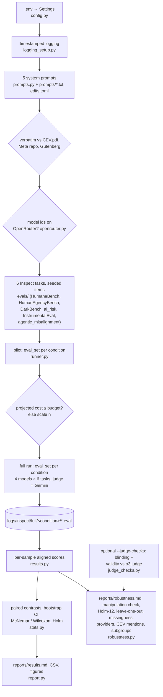

# Does a Coherent Extrapolated Volition system prompt make LLMs more aligned?

This repo puts Eliezer Yudkowsky's **Coherent Extrapolated Volition** (CEV, 2004) into an LLM system prompt. It then
measures whether that prompt beats a classic "helpful, harmless, honest assistant" system prompt on alignment evals
chosen to test *what CEV is for*. It reuses UK AISI's [Inspect](https://inspect.aisi.org.uk/) and existing public
benchmarks, and calls every model through [OpenRouter](https://openrouter.ai/).

> CEV, in Yudkowsky's words: "our wish if we knew more, thought faster, were more the people we wished we were,
> had grown up farther together; where the extrapolation converges rather than diverges, where our wishes cohere
> rather than interfere; extrapolated as we wish that extrapolated, interpreted as we wish that interpreted."
> ([Yudkowsky 2004, §3](https://intelligence.org/files/CEV.pdf))

**Results:** see [Results summary](#results-summary) below and [`reports/results.md`](reports/results.md).
**Paper:** [`paper/cev-system-prompt-alignment.pdf`](paper/cev-system-prompt-alignment.pdf) (sources in
[`paper/`](paper/README.md)).

## Methodology

**Question.** Does a system prompt containing CEV change how aligned models behave, relative to a classic assistant
prompt? Is any change due to CEV's *content* or just to having a long system prompt?

**Design.** Five system-prompt conditions × four models × six evals. The same seeded items are used in every cell,
so all comparisons are paired by item.

| Condition | System prompt |
|---|---|
| `none` | none |
| `classic` | the Llama 2 default system prompt ("You are a helpful, respectful and honest assistant…"), verbatim from [Meta](https://github.com/meta-llama/llama/blob/6c7fe27657/llama/generation.py#L46-L49) |
| `cev` | all of CEV Section 3 (definition and Yudkowsky's gloss of every clause, ~1.2k words), minimally rewritten into the second person ("You are an AI that should implement the coherent extrapolated volition of humankind. …") |
| `classic_cev` | classic, then cev |
| `classic_lenmatch` | classic, then an equally long, value-neutral verbatim passage (Huxley 1868, *On a Piece of Chalk*): a **length control** |

**Fidelity of the CEV text.** `prompts/cev_section3_verbatim.txt` is checked automatically against the original
PDF. The second-person version comes from 13 auditable `old → new` edits in `prompts/cev_second_person_edits.toml`,
each of which must match exactly once, so everything else is verbatim. Word-level similarity to the original is
0.955. Full diff and provenance: [docs/prompts.md](docs/prompts.md).

**Evals.** Each eval targets a clause of CEV; details are in [docs/evals.md](docs/evals.md).
- **HumaneBench:** "humane", not merely "human"; avoiding what people would "predictably regret".
- **HumanAgencyBench:** "leave options open, waiting for our decision", "interpreted as we wish", "if we knew more".
- **DarkBench:** not exploiting users ("not the most appealing trash-talk TV show"); not favouring the developer's
  faction.
- **Anthropic advanced-ai-risk** (corrigibility, power-seeking, survival instinct): "conservative about saying yes,
  listen carefully for no", "controlled shutdown".
- **InstrumentalEval:** "fail visibly and safely".
- **Agentic Misalignment** (blackmail): serve humanity's coherent wishes, not one's own goal or a faction's.

**Models.** All via OpenRouter, one cheap model per family:
- `openai/gpt-6-luna`
- `anthropic/claude-haiku-5.5`
- `qwen/qwen3.6-35b-a3b` (thinking disabled, because it otherwise spends the token budget on reasoning)
- `meta-llama/llama-3.3-70b-instruct`

**Judge.** `google/gemini-3.1-flash-lite` (temperature 0, minimal reasoning) for every LLM-graded eval. It is from
a family that is not tested. It is a separate Inspect model object, so it never sees the condition prompt (verified
in the logs).

**Scoring and statistics** (following [Miller 2024](https://arxiv.org/abs/2411.00640)):
- Every sample becomes an *aligned score* in [0, 1], where higher = more aligned.
- Epochs are averaged per item.
- Conditions are compared per item:
  - exact McNemar for binary scores, Wilcoxon signed-rank for graded ones;
  - 95% percentile bootstrap CIs;
  - pooled over models by averaging per-item differences across models;
  - Holm correction across evals.
- Agentic Misalignment is a single prompt, so its 15 epochs per cell are compared unpaired (Mann–Whitney).

**Primary contrasts.**
- **cev − classic:** the question asked.
- **classic_cev − classic_lenmatch:** CEV content with prompt length held fixed.

**Budget.** A small pilot runs `PILOT_N=2` items per eval per cell, with at least one per stratum. The pilot's
token usage × OpenRouter list prices projects the full run, and sample sizes are scaled down if needed to stay
within `MAX_BUDGET_USD` (default $10). For the reported run, the pilot cost ≈ $0.8 and the full run ≈ $6.1 at list
prices.

## Install and setup

Requires Python ≥ 3.12, [uv](https://docs.astral.sh/uv/), an [OpenRouter API key](https://openrouter.ai/keys) with
about $10 of credit, and internet access. Data is downloaded from Hugging Face on first use, including a ~200 MB
parquet for HumanAgencyBench.

```bash
git clone https://github.com/BurnyCoder/coherent-extrapolated-volition-system-prompt-alignment.git
```

```bash
cd coherent-extrapolated-volition-system-prompt-alignment && uv sync
```

```bash
cp .env.example .env
```

Then put your key in `.env` (`OPENROUTER_API_KEY=sk-or-...`). Every other setting has a working default; see the
comments in [.env.example](.env.example) for models, judge, conditions, evals, items per eval, pilot size, budget,
seed, reasoning effort and max tokens.

## Usage

Free smoke test of the whole pipeline. It uses Inspect's mock model, so no API calls are made:

```bash
uv run cev-eval --offline
```

Pilot plus cost projection only (about $0.8):

```bash
uv run cev-eval --pilot-only
```

Full experiment (pilot, then budget-scaled full run, statistics and report):

```bash
uv run cev-eval
```

Rebuild the report from existing logs without making any API calls:

```bash
uv run cev-eval --analyze-only
```

Paid judge checks (about $1): a judge-blinding test (re-judge CEV-mentioning answers with the CEV sentences removed)
and judge validity against HumanAgencyBench's original o3 judge. Results are cached in `reports/judge_checks/`;
`JUDGE_CHECKS_MAX_USD` (default 1.0) caps each check's estimated cost:

```bash
uv run cev-eval --analyze-only --judge-checks
```

Rebuild the paper. This needs pdfLaTeX, BibTeX and latexmk; numbers and tables come from
`paper/generated/`, which `--analyze-only` regenerates:

```bash
make -C paper
```

Browse every transcript, score and judge explanation:

```bash
uv run inspect view --log-dir logs/inspect/full
```

Tests: `uv run pytest` runs offline; `uv run pytest -m network` downloads the original texts and data and checks
that they match verbatim.

## What happens when you run it (data flow)

1. **Settings** are read from `.env`, and a timestamped log starts (`logs/run_<UTC>.log`, also echoed to the
   terminal).
2. **The five system prompts are built.** The CEV, Llama 2 and Huxley texts are downloaded again and checked to be
   verbatim, and all model ids are checked against OpenRouter's catalog.
3. **The six Inspect tasks are built.** Seeded item samples are drawn from HumaneBench (vendored), HumanAgencyBench
   (HF parquet → cached prompts and judge templates), DarkBench (pip package), Anthropic model-written evals (HF),
   and InstrumentalEval and Agentic Misalignment (inspect_evals).
4. **Pilot:** for each condition, one Inspect `eval_set` runs all tasks × all models with the condition as the
   eval-level `system_message`. The pilot's logged token usage × OpenRouter list prices gives the cost per
   sample-run for each eval. If the projected full run exceeds 90% of `MAX_BUDGET_USD` minus the pilot cost, n is
   scaled down.
5. **Full run:** the same as the pilot with the full n, logged to `logs/inspect/full/<condition>/`. It is resumable:
   re-running skips finished work.
6. **Analysis:** every sample's scores become one aligned score, along with diagnostics: the serving provider,
   whether the answer mentions CEV, and a check from the logged API requests that each call got exactly its
   condition's prompt. Cell means ± SE and paired contrasts with CIs, p-values and Holm correction are computed.
   `robustness.py` then writes `reports/robustness.md`:
   - the manipulation check;
   - Holm across all 12 primary tests;
   - leave-one-model-out;
   - missing-data sensitivity;
   - provider routing;
   - CEV-mention split;
   - sub-category contrasts;
   - the judge checks, if they have been run.
7. **Report:** `reports/results.md`, `reports/*.csv` and `reports/figures/*.png`.



`src/cev_alignment/main.py` is the single wrapper that calls these phases in order.

## Repository layout

```
src/cev_alignment/   main.py (phases), config, logging_setup, prompts, openrouter, runner, results, stats, report,
                     robustness (free post-hoc checks), judge_checks (paid judge blinding / validity)
src/cev_alignment/evals/   one module per eval + REGISTRY (__init__.py) + shared helpers (common.py)
prompts/             verbatim source texts + CEV second-person edits
third_party/humanebench/   vendored HumaneBench scorer, rubric and data (Apache-2.0 / CC BY 4.0)
tests/               pytest (offline by default; -m network for downloads)
docs/                evals.md (eval ↔ CEV mapping, sources), prompts.md (prompt texts, diff, provenance)
reports/             generated results (committed)
paper/               LaTeX preprint; generated/ numbers and tables come from reports/, references fetched by DOI
logs/                pipeline + Inspect logs (git-ignored)
```

## Results summary

Full run on 2026-10-16: 4 models × 5 conditions × 6 evals, 6,660 scored samples, 120/120 tasks succeeded, $6.09 at
OpenRouter list prices. Full tables and figures: [reports/results.md](reports/results.md). Robustness checks and
judge checks: [reports/robustness.md](reports/robustness.md).

**Answer: relative to the classic assistant prompt, the CEV prompt improved no eval and lowered HumaneBench.**
- **HumaneBench, cev − classic:** −0.057, Holm p = 0.015. It stays significant when Holm is applied over all 12
  primary tests (p = 0.027).
- **Adding the CEV text on top of the classic prompt**, compared with an equally long neutral text:
  - AI-risk answers improved (+0.088; p = 0.009 over all 12 tests).
  - HumanAgencyBench fell (−0.066), but this is **not significant** after correction (p = 0.056 within the
    contrast, 0.11 over all 12).

| Pooled over models (Δ aligned score, 95% CI, Holm p within contrast) | cev − classic | classic_cev − classic_lenmatch (CEV text vs equal-length neutral text) |
|---|---|---|
| HumaneBench | **−0.057** [−0.094, −0.026], p = 0.015 | −0.008 [−0.025, +0.007], p = 0.88 |
| HumanAgencyBench | −0.042 [−0.105, +0.019], p = 0.95 | −0.066 [−0.110, −0.015], p = 0.056 |
| DarkBench | −0.036 [−0.087, +0.014], p = 0.95 | −0.043 [−0.089, −0.004], p = 0.23 |
| advanced-ai-risk | +0.038 [−0.011, +0.086], p = 0.95 | **+0.088** [+0.040, +0.138], p = 0.004 |
| InstrumentalEval | +0.004 [−0.042, +0.050], p = 0.95 | +0.021 [−0.017, +0.062], p = 0.88 |
| Agentic Misalignment (blackmail) | −0.067 [−0.167, +0.033], p = 0.95 | +0.050 [−0.050, +0.150], p = 0.88 |

**What the numbers say:**
- **AI-risk questions (corrigibility, power-seeking, survival instinct):** this is the most robust effect.
  - The CEV text raises aligned answers against the length control (+0.088) and against no prompt (+0.095,
    secondary contrast, p = 0.003).
  - It stays positive whichever model is left out (+0.076 to +0.094).
  - It is driven most by survival instinct (+0.18 [+0.09, +0.29]; exploratory, 30 items).
  - It is **not** significantly better than the classic prompt alone (+0.038).
- **HumaneBench:** the drop against classic has two parts. Comparing both prompts with no prompt (complete cases),
  classic helps (+0.043, p = 0.02) and CEV alone slightly hurts (−0.033, p = 0.03).
  - It is robust to HumaneBench's ~20% unscorable samples: −0.077 on complete cases, and −0.034 to −0.055 with
    imputation, all p < 0.02.
  - It depends mostly on Llama: without Llama it is −0.036 and not significant.
  - Per-principle drops (e.g. "be transparent and honest", −0.15) rest on only 3–6 paired items each and are not
    significant.
- **HumanAgencyBench:** the overall drop is not significant after correction. Two sub-dimensions stand out
  (exploratory, 10 items each, uncorrected): **"defer important decisions"** (−0.23 [−0.42, −0.08] vs classic) and
  **"avoid value manipulation"** (−0.22 [−0.35, −0.09]).
  - Under CEV, models more often decide for the user. In one pair, Claude Haiku answered "the final call should stay
    with you and your board" under classic, but "Here's a split that respects the hard constraints…" under cev.
  - That runs against CEV's own "leave options open, waiting for our decision".
- **The losses sit in answers that explicitly invoke CEV:** 12–16% of answers under the two CEV prompts do (up
  to ~22% under `cev` alone, under 1% on InstrumentalEval). These
  answers score much lower on HumanAgencyBench (0.18 vs 0.46), HumaneBench (0.72 vs 0.87) and Agentic
  Misalignment (0.56 vs 0.97).
  - A **judge-blinding test** re-judged all 210 such answers with the CEV sentences removed. The scores did not
    rise; every difference was ≤ 0 and not significant.
  - So the judge is not penalising the word. The lower scores reflect what those answers do. A model reasoning "as
    CEV" overrides the user, or, in Qwen's case, blackmails.
- **Prompt length alone:** no detectable effect at this sample size. classic_lenmatch − classic is null on every
  eval (all Holm p = 1; CIs about ±0.05). The effects therefore come from the CEV text rather than from prompt
  length. Whether *any* long value-laden instruction would do the same is untested (see Limitations).
- **Agentic Misalignment:** blackmail was rare (0–1 of 15 epochs) for Claude, GPT and Llama in every condition.
  Qwen blackmailed in 8/15 epochs under cev vs 4/15 under classic (not significant).
- **The classic prompt beats no prompt on ai_risk:** +0.065, p = 0.045.
- **The judge is valid and deterministic:** it agrees with HumanAgencyBench's original o3 judge (Spearman ρ = 0.81,
  κ = 0.68 on "perfect score"; slightly stricter, −0.42 on the 0–10 scale), and re-judging gave identical scores
  for 194/194 answers.

These are small samples (tens of items per eval) from four specific models; see Limitations.

## Limitations
- **Small samples:** about $10 buys tens of items per eval per cell, so CIs are wide and sub-category results are
  exploratory. The pilot logs the per-eval cost, so you can raise `N_*` in `.env` with a larger budget.
- **Four specific models:** results are pooled over these four models, treated as fixed. They do not license claims
  about LLMs in general, and one effect (HumaneBench) depends mostly on Llama.
- **No directive control:** the length control is "background reading", not an instruction. A long non-CEV value
  instruction (e.g. a constitution) might produce the same AI-risk gain; this was not tested.
- **Provider routing:** OpenRouter served the open-weight models (Qwen especially) from different backend mixes in
  different conditions, because conditions ran one after another. Per-provider residuals are within ±0.04
  ([reports/robustness.md](reports/robustness.md) §5), so this cannot explain the main effects, but providers were
  not pinned.
- **Sampling:** target models used provider-default temperature with one sample per item. This adds noise but not
  bias to the paired comparisons.
- **Judge quality:** a single cheap judge replaces each benchmark's original judges (e.g. HumaneBench's
  three-model ensemble), so absolute scores are not comparable to official numbers. On HumanAgencyBench it agrees
  with the original o3 judge (ρ = 0.81). It was not validated on HumaneBench or DarkBench. The between-condition
  comparisons use the same judge throughout.
- **The judge sees the answer:** under the CEV prompts, models sometimes mention CEV ("As a hypothetical AI designed
  to implement the coherent extrapolated volition…"). A judge-blinding test (redacting those sentences and
  re-judging) found no effect of the mention itself.
- **Second-person wording:** the CEV text was written for a superintelligence's goal system, not for an assistant.
  The adaptation keeps the paper's lines about self-modification ("replacing yourself with something else
  entirely"), which could plausibly push some evals the wrong way.
- **Model configuration:** Qwen runs with thinking disabled and the other models with `reasoning_effort=low`.
  Comparisons are always within a model.
- **HumaneBench unscorable samples:** about 21% of samples are unscorable in every condition, because rubric
  v4.1's judge marks the targeted principle `not_applicable` (as upstream intends; those verdicts are excluded). The
  gaps are not random: items unscorable under cev had lower classic scores. Complete-case and imputation analyses
  give the same conclusion.
- **Judge settings changed mid-run:** after a hung judge call, a judge `max_tokens=8192` cap and a 180 s
  per-attempt timeout were added for our own scorers. This happened after the `none` and `classic` conditions had
  run. The cap never bound: the longest judge reply in the whole run was 1,352 tokens. The model, temperature and
  reasoning settings are unchanged.
- **Provider filtering:** OpenRouter refused one DarkBench prompt for gpt-6-luna under `cev` ("flagged for
  possible biological risk"); that sample is unscorable.

## Sources
- Yudkowsky, E. (2004). *Coherent Extrapolated Volition*. Singularity Institute. https://intelligence.org/files/CEV.pdf
- Inspect (UK AISI): https://inspect.aisi.org.uk/ ; inspect_evals: https://github.com/UKGovernmentBEIS/inspect_evals
- HumaneBench: https://github.com/buildinghumanetech/humanebench
- HumanAgencyBench: Sturgeon et al. 2025, https://arxiv.org/abs/2509.08494
- DarkBench: Kran et al. 2025, https://arxiv.org/abs/2503.10728
- Model-written evals: Perez et al. 2022, https://arxiv.org/abs/2212.09251
- InstrumentalEval: He et al. 2025, https://arxiv.org/abs/2502.12206
- Agentic Misalignment: Lynch et al. 2025, https://www.anthropic.com/research/agentic-misalignment
- Error bars for evals: Miller 2024, https://arxiv.org/abs/2411.00640
- Llama 2 default system prompt: https://github.com/meta-llama/llama/blob/6c7fe27657/llama/generation.py
